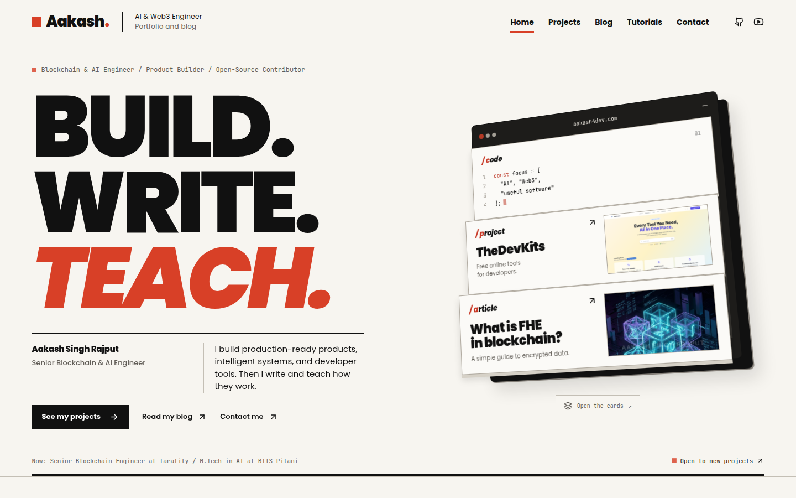
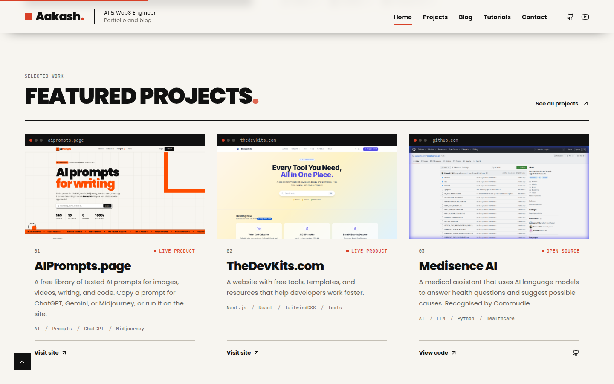
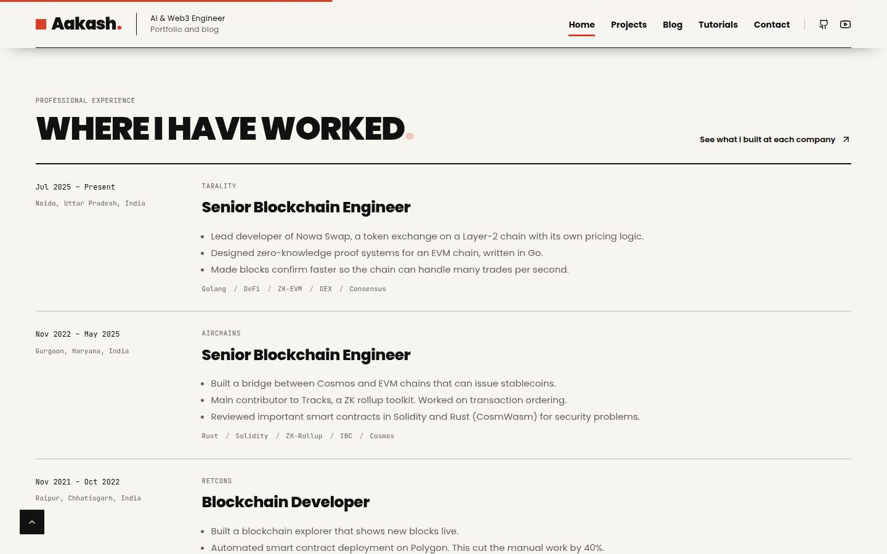
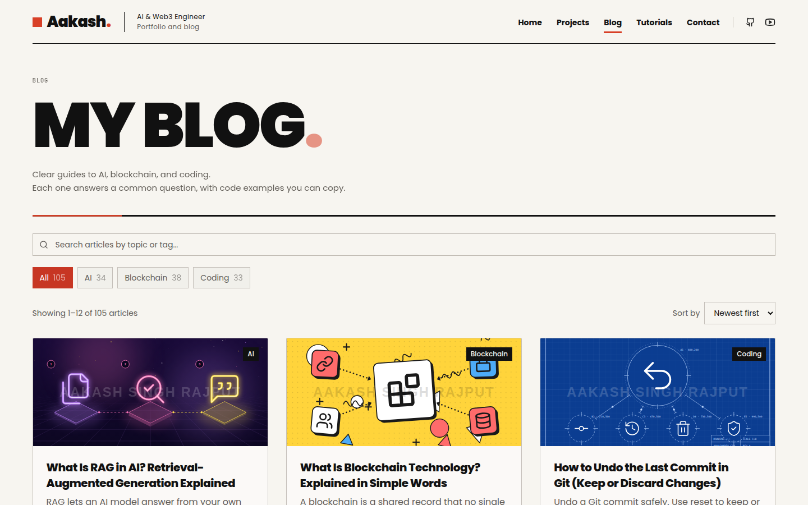
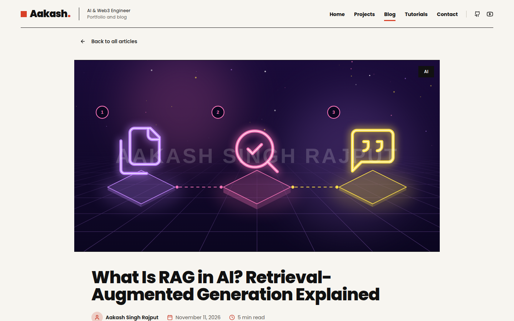
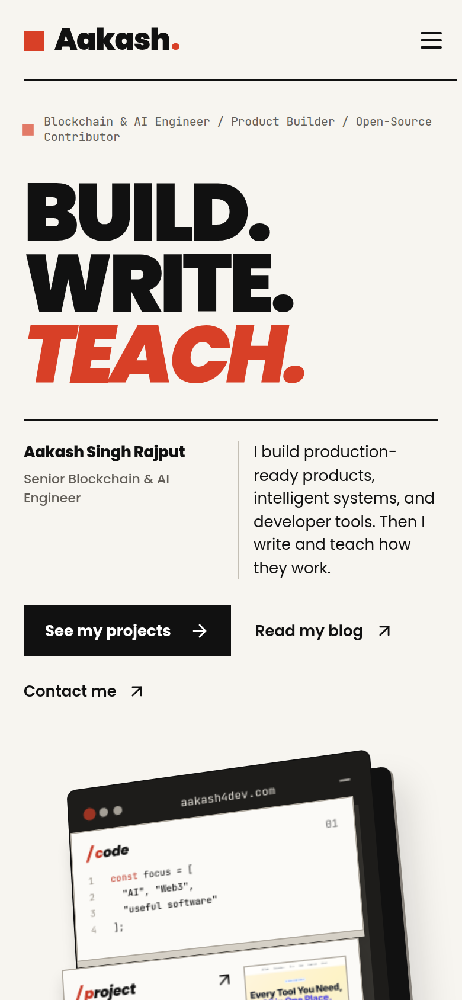

# aakash4dev.com

The portfolio and blog of **Aakash Singh Rajput**, a Senior Blockchain & AI Engineer.

**Live site: [www.aakash4dev.com](https://www.aakash4dev.com)**



## What's on the site

- **Portfolio**: featured products, work experience, education, skills, and services.
- **Blog**: 105 articles on AI, blockchain, and coding. Each one answers a common question with examples and code you can copy.
- **Tutorials**: video tutorials, played on demand so the page stays fast.
- **Contact**: a contact page plus a contact block at the bottom of every page.

| Featured projects | Work experience |
|---|---|
|  |  |

| Blog | Article |
|---|---|
|  |  |

<p align="center"></p>

## Features

- **Editorial design**: paper-white pages, heavy black type, and red accents. The hero has a 3D card stack that tilts with the mouse and opens on click.
- **Fast pages**: every page, including all 105 articles, is pre-built as static HTML.
- **SEO**:
  - A sitemap and robots.txt.
  - A canonical URL on every page.
  - Open Graph and Twitter cards.
  - Structured data: Person and WebSite on the home page, and BlogPosting, BreadcrumbList, and FAQ on articles.
- **Blog tools**:
  - Search, category filters, and sorting.
  - A table of contents on each article.
  - Copy buttons on code blocks.
  - Math rendering with KaTeX.
  - Related articles.
- **Accessible**: keyboard navigation, a skip link, reduced-motion support, and alt text on images.

## Tech stack

- [Next.js 15](https://nextjs.org/) (App Router, static generation)
- React and TypeScript
- Tailwind CSS
- Framer Motion
- React Markdown with remark-gfm and KaTeX
- Vercel for hosting and analytics

## Run it locally

You need Node.js 20 or later.

```bash
git clone https://github.com/aakash4dev/portfolio-website.git
cd portfolio-website
npm install
npm run dev
```

Then open [http://localhost:3000](http://localhost:3000).

```bash
npm run build          # production build (also checks types)
npx tsc --noEmit       # type-check only
```

## Project structure

```
app/                 pages and routes (home, projects, blogs, tutorials, contact)
  sitemap.ts         sitemap.xml, including every article
  robots.ts          robots.txt
components/
  sections/          home page sections (Hero, About, Projects, Experience, ...)
  site/              shared page parts (project rows, article list)
content/blog/        the 100 researched articles as Markdown, by category
lib/
  site.ts            site address, email, navigation, and social links
  projects.ts        project data
  experience.ts      jobs and education
  blogs.ts           the original articles and the combined article list
  content/           articles built from content/blog/
scripts/             blog build, cover image, and validation scripts
public/              images, project screenshots, and article covers
```

To change the site address, edit `siteUrl` in `lib/site.ts`. Canonical URLs, the sitemap, and share links all use it.

## Writing articles

The researched articles are Markdown files in `content/blog/<category>/`, where the categories are `ai`, `blockchain`, and `coding`. After adding or editing one, run:

```bash
npm run blogs:build    # build lib/content/articles.ts, draw covers, check every article
npm run blogs:check    # check the articles and type-check the blog code
```

New articles appear in the sitemap automatically. How the topics were chosen is described in [docs/blog-research.md](docs/blog-research.md).

Image sources and credits for the charts in `public/blogs/evidence/` are listed in `public/blogs/asset-provenance.json`. The language-comparison article includes a local Node.js and Python benchmark. Rerun it with `python3 scripts/benchmarks/run-language-benchmark.py`, which needs Python, Node, and matplotlib, then rebuild.

## License

The **source code** is released under the [MIT License](LICENSE). You are welcome to learn from it or use it for your own site.

The **articles, personal details, and images** are not covered by the MIT License and remain all rights reserved. See [LICENSE](LICENSE) for the exact list. Please don't republish the articles or use my photos.

## Contact

- Website: [www.aakash4dev.com](https://www.aakash4dev.com)
- GitHub: [@aakash4dev](https://github.com/aakash4dev)
- LinkedIn: [aakash4dev](https://www.linkedin.com/in/aakash4dev)
- X: [@aakash4dev](https://x.com/aakash4dev)
- YouTube: [@aakash4dev](https://www.youtube.com/@aakash4dev)
